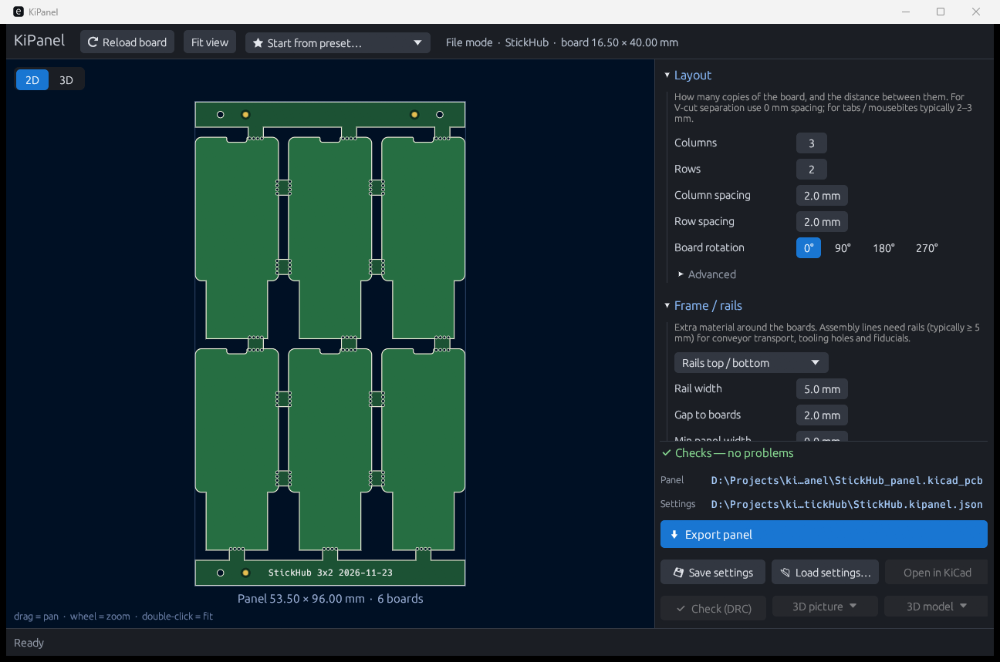
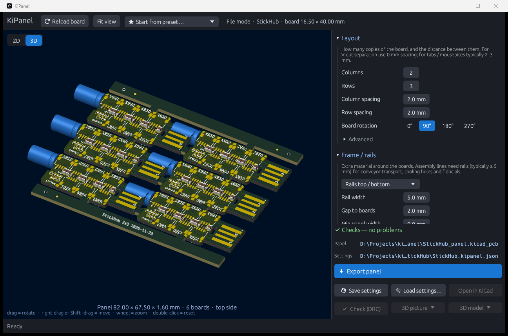
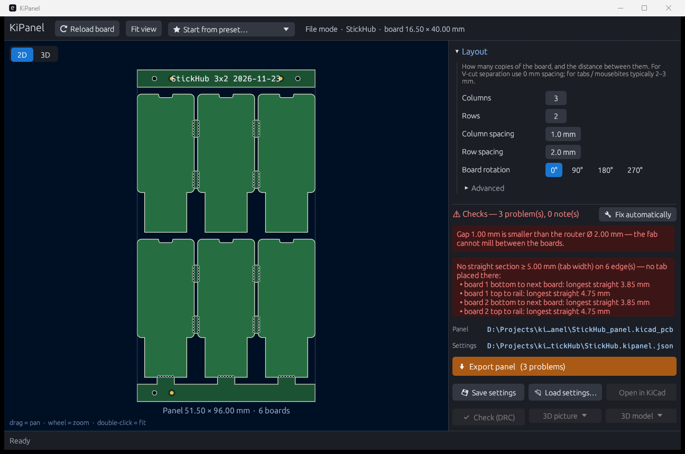

# KiPanel

[](https://github.com/kahlenberg/kipanel/actions/workflows/build.yml) [](https://github.com/kahlenberg/kipanel/releases/latest) [](LICENSE)

A PCB panelizer plugin for **KiCad 9+** with a live preview. Open your board, click the KiPanel button, set rows / columns / rails / separation, and export a ready-to-order panel as a new `.kicad_pcb`.

Written in Rust (egui), talks to KiCad through the IPC API. Runs on Windows, Linux and macOS.



| 3D preview with components | Live checks and automatic fixes |
|---|---|
|  |  |

*The screenshots show the StickHub demo board that comes with KiCad.*

## Features

- **Grid layout** – rows, columns, spacing, board rotation 0 / 90 / 180 / 270°
- **Frame** – none, rails top/bottom, rails left/right, full frame, minimum panel size
- **Separation** – V-cut, tabs + mousebites, or tabs only (tabs are placed only on straight edges)
- **Assembly aids** – tooling holes (3 or 4, NPTH/PTH), fiducials (3 or 4, top/bottom/both), up to 4 panel texts
- **2D / 3D preview** – switch in the top-left corner of the preview. The 3D view shows the panel with the components, copper and silkscreen of your board, plus rails, slots, tabs, holes and text, and updates live like the flat view (drag = rotate, right-drag or Shift+drag = move, wheel = zoom, double-click = reset). The board model is fetched from KiCad once per board (`kicad-cli`, a few seconds up to a minute); until then the bare panel is shown.
- **Live checks** – V-cut crossing a board, gaps narrower than the router bit, no room for a tab, holes/fiducials off the rail or overlapping, text that does not fit, panel larger than the maximum size
- **Fix automatically** – one button next to the checks adjusts the settings so the reported problems go away (wider gaps or rails, narrower tabs, moved holes, fiducials and texts, …). It lists every change and can be undone.
- **Presets** – proven starting points (mousebites + rails, V-cut + rails, bare boards)
- **Export** – a new board file, your original board is never modified
  - every copy gets fresh UUIDs and its own nets (`Board_N-<net>`, pattern can be changed)
  - Edge.Cuts is replaced by the panel outline (union of boards, rails, tabs and backbones)
  - V-cut lines on a selectable layer, mousebites/tooling holes as NPTH footprints, fiducials as SMD pads
- **After export** (uses `kicad-cli`, which comes with KiCad)
  - **Check (DRC)** – runs KiCad's design rule check on the panel, lists the findings and marks them in the preview
  - **3D picture** – renders the panel (top, bottom or angled) to a PNG and shows it
  - **3D model** – exports the panel as STEP, GLB, STL, PLY, VRML, BREP or XAO
- **Settings per board** – saved as `<project>/<board>.kipanel.json` and loaded again automatically

Less common options sit in a collapsed **Advanced** group inside each section, so the main settings stay short:

| Section | Advanced options |
|---|---|
| Layout | flip every second column / row / checkerboard by 180°, different spacing for every second gap, backbones (solid bars in the gaps that the boards are tabbed to) |
| Frame / rails | maximum panel size, chamfered or rounded panel corners, copper fill on the rails |
| Separation | tabs by distance instead of count, separate tab width for left/right edges, mousebite row longer than the tab, rounded inner corners (router radius), V-cut lines extended past the panel edge |
| Tooling holes & fiducials | distance from the panel edge across the rail |
| Panel text | layer, position on the rail, shift, line thickness; placeholders `{date}` `{board}` `{rows}` `{cols}` `{count}` `{width}` `{height}` |
| Output file | net name and reference patterns (`{n}`, `{orig}`), outline line width, page size fitted to the panel, drill / place origin on a panel corner |

## Requirements

- KiCad **9.0 or newer**
- The KiCad API server must be on: **Preferences → Plugins → Enable KiCad API** (then restart KiCad)

## Install

### Option A – prebuilt package

If the [Releases](https://github.com/kahlenberg/kipanel/releases) page has a zip for your system:

1. Download `kipanel-pcm-windows.zip`, `kipanel-pcm-linux.zip` or `kipanel-pcm-macos.zip`.
2. In KiCad open **Plugin and Content Manager → Install from File…** and pick the zip.
3. Restart KiCad. A **KiPanel** button appears in the PCB editor toolbar.

The macOS package is built for Apple Silicon. The programs are not code-signed, so Windows SmartScreen or macOS Gatekeeper may ask for confirmation the first time; building from source (option B) avoids that.

On Linux / macOS, if the button does nothing after this, the program may have lost its executable flag while unpacking. Fix it with `chmod +x <plugins folder>/com.mubin.kipanel/kipanel` (folders are listed below), or use option B.

### Option B – build from source

You need [Rust](https://rustup.rs), **CMake** and a C compiler (one dependency, the `nng` messaging library, is built from C source).

| System | Prerequisites |
|---|---|
| Windows | Rust, Visual Studio Build Tools ("Desktop development with C++", includes CMake) |
| Debian / Ubuntu | `sudo apt install build-essential cmake zip` + Rust |
| Fedora | `sudo dnf install gcc gcc-c++ make cmake zip` + Rust |
| macOS | `xcode-select --install`, `brew install cmake` + Rust |

Then clone this repository and run the install script. It builds a release binary and copies it into KiCad's plugin folder:

```bash
git clone https://github.com/kahlenberg/kipanel.git
cd kipanel
```

```bash
# Linux / macOS
./install-dev.sh
```

```powershell
# Windows (PowerShell)
.\install-dev.ps1
```

Finally, in the KiCad PCB editor choose **Tools → External Plugins → Refresh Plugins** (or restart KiCad).

Where the plugin is installed:

| System | Folder |
|---|---|
| Windows | `Documents\KiCad\9.0\plugins\com.mubin.kipanel` |
| macOS | `~/Documents/KiCad/9.0/plugins/com.mubin.kipanel` |
| Linux | `~/.local/share/kicad/9.0/plugins/com.mubin.kipanel` |

Other setups:

```bash
KICAD_VERSION=10.0 ./install-dev.sh          # a different KiCad version
.\install-dev.ps1 -KiCadVersion 10.0         # same on Windows
# Flatpak KiCad keeps its data elsewhere:
KICAD_PLUGIN_DIR=~/.var/app/org.kicad.KiCad/data/kicad/9.0/plugins ./install-dev.sh
```

To uninstall, delete the `com.mubin.kipanel` folder.

## Usage

1. Open your board in the KiCad **PCB editor** and click the **KiPanel** toolbar button. KiPanel reads the board as it is right now, including unsaved changes.
2. Optionally pick **Start from preset…** in the toolbar to fill in a sensible combination.
3. Adjust the settings on the right. The preview updates immediately, and hovering a setting highlights what it affects. Switch between the flat view and the 3D view with **2D | 3D** in the top-left corner of the preview.
   - **Layout** – number of boards and the gaps between them
   - **Frame / rails** – extra material for the assembly line
   - **Separation** – how boards are broken out (V-cut needs 0 mm spacing; mousebites typically 2–3 mm)
   - **Tooling holes & fiducials**, **Panel text**
   - **Output file** – folder, file name postfix, V-cut layer, unique references
4. Watch **Checks** at the bottom right. Red entries are real problems (for example a V-cut running through a board), yellow ones are notes. **Fix automatically** changes the settings so they go away, shows what it changed, and offers **Undo**. Problems that need a decision (for example a panel larger than your maximum size) are left for you.
5. Click **Export panel**. The result is written to `<project>/panel/<board>_panel.kicad_pcb` by default, and can open in KiCad right away.
6. Optionally check and view the exported panel with the three buttons below:
   - **Check (DRC)** runs KiCad's design rule check. Findings are listed by rule and marked in the preview; the full report is saved as `<board>_panel.drc.json`. Most findings come from the board itself, so fix them there, reload and export again.
   - **3D picture** renders a top, bottom or angled view to `<board>_panel_<view>.png` and shows it. *Save a copy as…* stores it somewhere else. *High quality* is slower.
   - **3D model** writes `<board>_panel.step` (or `.glb`, `.stl`, `.ply`, `.wrl`, `.brep`, `.xao`) next to the panel. Large panels can take a few minutes.

   These buttons work on the exported file, so export again after changing settings.
7. **Save settings** stores the configuration next to your board, so the next session starts where you left off. The button turns amber with a `*` while there are unsaved changes.

File paths are shown above the Export button and in the status bar after saving or exporting. Click a path to open its folder.

### Preview and shortcuts

| Action | 2D view | 3D view |
|---|---|---|
| Move | drag | right-drag or Shift+drag |
| Rotate | – | drag |
| Zoom | mouse wheel | mouse wheel |
| Fit to window | double-click, or **Fit view** | double-click (also resets the rotation), or **Fit view** |

| Action | How |
|---|---|
| Save settings | Ctrl+S (Cmd+S on macOS) |
| Export panel | Ctrl+E (Cmd+E on macOS) |
| Re-read the board from KiCad | **Reload board** |

### Without KiCad (standalone mode)

Pass a board file to try KiPanel without a running KiCad:

```bash
cargo run -- examples/demo.kicad_pcb
```

Everything works except starting from the toolbar; *Open in KiCad* needs `pcbnew` to be installed.

## Troubleshooting

- **"Connect failed"** – the API server is off. Enable it under Preferences → Plugins, restart KiCad, and keep the PCB editor open.
- **"no board open in PCB editor"** – open the board in the PCB editor (not only the project manager), then press **Reload board**.
- **No KiPanel button** – run Tools → External Plugins → Refresh Plugins, and check that the plugin folder above matches your KiCad version.
- **3D view says "Components not shown"** – the board model could not be fetched from `kicad-cli` (message shown next to the switch), or the graphics driver does not offer OpenGL 3.3. The bare panel is shown instead; everything else works. Components without a 3D model in KiCad are missing in the view as well.
- **3D view is slow** – every board copy is drawn with all its parts, so large panels of dense boards need a reasonable graphics card. The flat view is not affected.
- **"could not start kicad-cli"** – the 3D view with components, DRC, 3D picture and 3D model need `kicad-cli`. KiPanel looks next to the PCB editor, in the standard install folders, and on `PATH`. If KiCad is installed somewhere unusual, add its `bin` folder to `PATH`.
- **Exported 3D model has no components** – footprints that reference models relative to the project (`${KIPRJMOD}`) may not be found from the `panel` sub-folder. If that happens, set the output folder to the project folder itself.
- **Linux: Browse (…) buttons do nothing** – the file dialogs use the XDG desktop portal; install `xdg-desktop-portal` plus the backend for your desktop (`-gtk`, `-kde`, …). You can always type paths by hand.

## Development

```bash
cargo run                        # needs KiCad with a board open and the API enabled
cargo run -- examples/demo.kicad_pcb   # standalone
cargo test
./package.sh                     # or .\package.ps1 on Windows
```

The package scripts create `dist/com.mubin.kipanel/` (copy into the plugins folder by hand) and `dist/kipanel-pcm-<platform>.zip` (for *Install from File…*). The binary is platform specific, so each system gets its own zip.

GitHub Actions (`.github/workflows/build.yml`) builds and tests on Windows, Linux and macOS for every push and attaches the three zips as artifacts. Pushing a tag such as `v1.0.0` publishes them as a release. Changes per version are listed in [CHANGELOG.md](CHANGELOG.md).

Source layout: `src/board.rs` (outline extraction), `src/panel.rs` (panel geometry and checks), `src/export.rs` (writing the panel board), `src/tools.rs` (`kicad-cli` jobs: DRC, render, 3D export), `src/view3d.rs` (3D preview: camera, bare panel and overlays), `src/gl3d.rs` (3D preview: board model with components, OpenGL), `src/optimize.rs` (automatic fixes), `src/sexpr.rs` (KiCad file parser), `src/main.rs` (GUI).

## Known limits

- Arcs in the outline are exported as polylines (2° segments)
- Groups and generated items (tuning patterns) are not copied
- Only the largest outline (plus its cutouts) is used; separate outlines are ignored
- Tabs are placed only on straight edges that lie on the board's bounding box, and boards rotate in 90° steps
- Copper fill on the rails is solid only (no hatch pattern), on the front and back layer
- Zones are copied with the fill they had in your board; they are not refilled for the panel

## License

[MIT](LICENSE)
